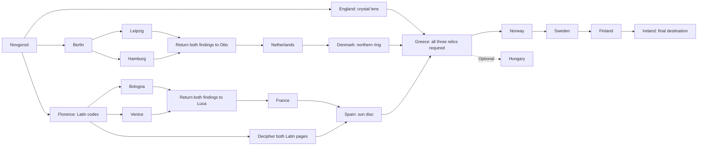

# The Ninth Meridian


*Concept art for the voyage — generated illustration, not a gameplay screenshot.*

A browser RPG prototype about an epic voyage through Europe, where understanding people is part of solving the mystery. Your native language is Czech. NPCs speak their own languages; phrasebooks, magical scrolls, and travelling companions help you understand them.

See [the design document](docs/design.md) for the game philosophy, gameplay systems, content structures, runtime state, and development direction.

Country labels have medieval flavor—Bohemia, Upper Hungary, the Holy Roman Empire, Ruthenia, and other kingdoms and regions—while the map uses today's borders. These are story names rather than a reconstruction of one historical year.

Drag the minimap with the left mouse button to pan, and use the wheel to zoom around the pointer. **Reset view** restores the discovered-region view. City clicks still travel; dragging over a city does not. Zoom buttons and keyboard city activation remain available.

## Play the prototype

Run `python -m http.server 8000` from this directory and visit `http://localhost:8000`. A static server is required because the browser fetches game content from JSON files; opening `index.html` directly with `file://` is unsupported and shows server instructions. No package install, build, backend application, or account is needed. All game scripts and content are local; optional Google fonts fall back to system fonts offline.

Talk to Ada about Eliáš, ask for a hint or identify the nine-pointed star, and accept the map. At the bookseller, choose the polite browsing response to open the shop, then buy/read the border phrasebook before travelling. Follow the witnesses through Bratislava, Kraków, Lviv, and Novgorod. Invite Mira in Bratislava to see companion translation notes. After Novgorod, follow the three relic routes in any order, decipher the Latin codex, and reunite in Athens. Switch easy mode off to compare the experience. Replay any conversation without duplicating quest rewards. Start a new voyage resets everything. State is held in memory and resets on page refresh.

## Country investigations

Germany now branches from Berlin to Leipzig and Hamburg; Italy branches from Florence to Bologna and Venice. Visit the two cities in either order. Each has a witness and an expert, with a choice between checking written records and reconstructing physical evidence. Record the witness account, solve the discrepancy, then return both city findings to Otto or Luca. Amsterdam and Lyon open after that return visit. Each city pays eight coins once. Sofie and Lucia accompany these detours, and the existing German/Italian notes include the new phrases. The journal lists each lead and provides visit buttons.

## Three relic routes and the Greek reunion

The prototype now has 22 destinations, a playable reunion, and a final journey to Ireland. Novgorod unlocks three independent starting destinations: London, Berlin, and Florence. You can switch between branches and revisit earlier locations without losing progress.

| Route | Journey | Evidence and reward |
| --- | --- | --- |
| Western | London, England (Britain) | Show the silver star to obtain the **crystal lens** |
| Northern | Berlin → Leipzig + Hamburg → Berlin → Amsterdam → Copenhagen | Verify the print and tide record, report to Otto, then obtain the **northern ring** |
| Southern | Florence → Bologna + Venice → Florence → Lyon → Toledo | Verify the solar leaves and mirror, report to Luca, decipher the codex, then obtain the **sun disc** |
| Reunion | Athens, Greece | Bring all three relics after completing all three routes, restore the astrolabe, and find Eliáš |



Luca in Florence gives you the codex and a limited Latin glossary. Read the glossary, then choose **Read book** in the satchel. The codex opens a two-page Latin dialogue puzzle: identify the three parts, then identify the country where the routes meet. Wrong interpretations return you to the text. The glossary mixes word hints with a whole-phrase translation; scrolls can translate the current page and responses. You can reread a carried codex from any destination. **Travel to Toledo requires only completing France.** Receiving the sun disc still requires the French letter and successfully deciphering both Latin pages. The journal offers a codex button and reminder, and disabled travel/response choices show their missing requirements.

New destinations have local-language quest NPCs and booksellers, with affordable limited travel dictionaries. Latin uses its own knowledge score and normal translation rules. Greece requires both the completed branch milestones and the actual lens, ring, and disc. Quest items remain in your satchel after completion; replay does not duplicate them or progress flags. The journal shows each route and its relic status.

## Beyond Greece: the last road to Ireland

The Greek reunion grants the restored astrolabe and unlocks Oslo, Norway. Ingrid gives a northern token; Erik in Stockholm, Sweden exchanges its evidence for an aurora chart; Aino in Helsinki, Finland gives the key to the last Irish gate. Niamh in Galway speaks Irish and welcomes you to the library of languages. **Ireland is the final destination and the only full-voyage completion milestone.** Greece now ends the relic-gathering phase.

Budapest, Hungary is unlocked after Greece as an optional detour. Eszter offers wisdom and a scholar's compass, but visiting Hungary is never required for Ireland. The new guides also sell limited dictionaries and translation scrolls through their dialogue options. Norwegian, Swedish, Finnish, Hungarian, and Irish all use the existing knowledge and translation rules.

## RPG shops and supplies

Eleven additional sellers offer general supplies, food, weapons, or remedies. Prague has a general store, food stall, and arms merchant; Bratislava and Florence have food sellers; Kraków and Oslo have weapon sellers; Berlin has an outfitter; Toledo and Athens have potion sellers; Galway has a general store. They speak their local language, provide supply advice, and can rebuke nonsense or dismiss rude customers.

The 17 new items include bread, cheese, dried meat, rations, a water flask, rope, torches, bandages, healing and stamina potions, antidote, arrows, an iron sword, short bow, shield, leather armour, and boots. Arrow purchases give **20 arrows for 6 coins**; other purchases give one item. Food, potions, ammunition, and basic supplies stack. New weapons and wearable equipment use `"stackable": false` so duplicate purchases are blocked. Purchases require a shop node, the seller's stock listing, and enough coins.

Item JSON supports `price`, `purchaseQuantity`, `stackable`, `slot`, `stats`, `effects`, `ammunition`, and `compatibleWeapon`. Bow/ammunition references and purchase quantities are validated. Combat, equipping, eating, healing, and creature-defeat quests are not implemented yet; these fields prepare the inventory for those systems. Current gameplay is buying and carrying supplies, not applying their future effects. Quest-delivery resources remain distinct from general-store supplies to preserve the fetch-quest objectives.

## Travelling companions

You can travel with **one companion at a time**. Recruitment never replaces the current companion: the candidate explains that you already have someone with you. Use **Dismiss companion** first, then return to the candidate and invite them. Dismissal is also a response in the companion conversation.

The companion panel always offers **Talk to companion**, including away from their home city. Conversations include rumors, small pieces of wisdom, local happenings in the game's fictional setting, and advice that changes with quest progress. Advice and rumors do not grant quest items or complete milestones. Repeating conversations does not farm knowledge or duplicate journal entries. Changing UI language keeps these authored utterances in the speaker's language.

| Companion | First meeting | Interpretation | Travel limits |
| --- | --- | --- | --- |
| Tereza, travelling teacher | Prague | Slovak and Polish → Czech | Leaves on arrival in Bratislava; travels only between Prague and Bratislava |
| Mira, caravan guide | Bratislava, after her clue | Polish and Ukrainian → Slovak | Accompanies the Bratislava–Krakow–Lviv–Novgorod route; leaves before going beyond it |
| Rowan, wandering librarian | London | English, French, Irish → Czech | Leaves on arrival in Athens or before departing for the northern finale |
| Sofie, workshop interpreter | Berlin | German, Dutch, Danish, English → Czech | Also visits Leipzig and Hamburg; travels Berlin–Amsterdam–Copenhagen; leaves on arrival in Copenhagen |
| Lucia, manuscript scholar | Florence | Italian, French, Spanish, Latin → Czech | Also visits Bologna and Venice; travels Florence–Lyon–Toledo; leaves before going beyond that route |
| Sigrid, northern courier | Oslo | Norwegian, Swedish, Finnish, English, Irish → Czech | Travels Oslo–Stockholm–Helsinki–Galway; leaves on arrival in Galway |

Departures show the companion's farewell and waiting city. **Known companions** records where people you have met can be found. A dismissed companion waits in the current city; a companion leaving before travel stays in the departure city, and one leaving on arrival stays at the destination. They appear in that city's NPC list when you return and can be recruited again. The original home listing moves with them. Re-recruiting does not remove their route limits. Clicking the current destination again does not trigger another arrival.

Translation assistance works in both difficulty modes and uses authored translations only. An interpreter can translate their native language into a different configured output language; an output identical to the source adds no redundant note. Mira retains her limited Slovak output, so understanding her notes still benefits from the border phrasebook.

## Optional errands and local wisdom

### Simulated gathering

Use **Explore nearby** to collect materials without a map or combat system. In Prague, accept Janek's quest, gather **3 wood**, then hand it in for **12 coins and 2 torches**. In Bratislava, accept Zuzana's quest, pick **2 flowers**, and return for **10 coins and a healing potion**. Gather buttons add real inventory quantities and immediately update available dialogue responses. The journal shows collected/required counts and a **Return to quest giver** button.

Florence's garden can provide lavender for Marie, and Stockholm's quarry can provide ore for Bjørn, as alternatives to talking to their suppliers. Sources require their matching quest to be accepted and are limited per voyage: 5 wood, 4 flowers, 3 lavender, and 3 ore. Travelling or replaying a conversation does not replenish them; starting a new voyage does. Gathering never grants the delivery reward automatically: return, select the hand-in response, and the materials are consumed. Rewards remain one-time.

Define a location's `actions` array with entries such as `{"id":"wood_errand_gather","label":"Gather wood at the forest edge","item":"wood","count":1,"limit":5,"requires":{"milestone":"wood_errand_started"}}`. `count` is the amount gained per click; `limit` is total material available for the voyage. Response requirements can include `"quantities":{"wood":3}`. Side quests optionally define `fetchCount`, `giver`, and `location` for progress and return controls. The engine exposes `gatheringActions()`, `canGather(id)`, and `gather(id)`, with counters in `state.gathered`.

| Giver | Fetch task | Reward |
| --- | --- | --- |
| Boris, Prague | Collect salt from Dana in Bratislava and return | 18 coins + travelling boots |
| Marie, Lyon | Collect lavender from Rosa in Florence and return | 15 coins + 3 healing salves |
| Petros, Athens | Collect rope from Freja in Copenhagen and return | 20 coins + brass compass |
| Bjørn, Oslo | Collect ore from Liv in Stockholm and return | 24 coins + warm cloak |

Accept an errand, visit its supplier, then return to hand over the requested resource. Each giver also offers unrelated wisdom recorded in the rumor journal. Deliveries consume one requested item and grant their reward once per voyage. Replay, supplier revisits, and duplicate turn-ins cannot farm gold or reward stacks. The journal lists optional errands, their status, and their rewards. Equipment and salves are inventory rewards for now; exploration statistics, equipping, and consumable use will be added with later RPG systems.

Side quests have separate files in `data/quests/`. Reward effects use `{"type":"reward","id":"salt_errand","gold":18,"take":[{"item":"salt","count":1}],"items":[{"item":"river_boots","count":1}]}`. The reward ID tracks one-time payment; all registered quests contribute their declared milestones to validation. `state.rewarded` records paid rewards and resets on a new voyage.

## Branched conversations

Every witness has a greeting, an evidence question, an optional hint, a clue, and a farewell. Responses are authored phrases in the NPC’s language, including believable answers, absurd answers, and threats. An absurd reply can lead to a rebuke and a second chance; a threat or a repeated wrong answer on a hint branch dismisses you. Dismissals grant no new reward. Replay or reopen the conversation to recover; this prototype has no permanent reputation penalty. The final archive and astronomer questions require the actual key or star, not just the right words. Mira can join you or let you travel alone.

Response meanings appear below the offered lines when covered by a read dictionary in easy mode, a companion, or a scroll. Unknown responses remain selectable so you can reason from context or risk a guess. No UI label identifies the correct answer. The last selected response appears above the NPC’s next line. Switching Czech/English UI never translates these utterances.

### Language knowledge

Most conversations also offer extra silly or improper lines, such as declaring your spoon king, paying with invisible cheese, demanding all the NPC's possessions, or insulting their advice. These appear in greetings and some evidence/shop phases. Nonsense leads to a rebuke with an apology/restart option; insults and demands dismiss you. Detours grant no quest rewards. Existing knowledge thresholds hide rude options at 30 and nonsense at 60, including these new lines. Shared multilingual banter is authored in `data/phrases.json`, while each dialogue explicitly lists its options and reaction nodes.

Some nonsense responses are Easter eggs. In England, Germany, France, and Spain you can announce that your hovercraft is full of eels and receive a different amused reaction from each NPC. In Toledo, an Esperanto request asks the porter to deal with a frog in your bidet. These detours grant no relics and let you return to the evidence question. They disappear at the normal nonsense-filter threshold. Choice `language` optionally overrides the NPC language for a deliberately mixed-language response; its text, translation hints, and last-response display retain that language. `easterEgg` is an optional content tag, not a label revealing the joke in the UI.

Each language has a separate knowledge score from 0 to 100, shown in the voyage panel. Czech, your native language, starts at 100; a newly encountered language starts at 0. Below 30, sensible, rude, and nonsensical responses are mixed together. At 30, rude responses disappear. At 60, nonsensical responses disappear too: only sensible replies remain, including optional hints and decisions such as inviting or declining a companion. Item requirements still apply.

Reading a dictionary grants 3 points for each distinct whole phrase and 1 point per distinct word or verb in its source language. Rereading or studying the same phrase/lemma in another book gives no extra points; an entry’s extra inflected forms give no additional points. Empty books give none. Choosing a sensible response grants 8 points for that NPC’s current dialogue node, once per voyage. Replaying a node or looping through a rebuke cannot farm points. Wrong replies give no points. Knowledge persists across destinations and conversations and resets with a new voyage.

Knowledge filters choices in both difficulty modes; easy mode separately controls dictionary translation notes. Scrolls and companions provide translation assistance without granting permanent knowledge by themselves. Knowledge does not automatically translate unknown phrases. These thresholds and gains are configurable in `WORLD.languageLearning`; choices declare `quality: 'sensible'`, `'rude'`, or `'nonsense'`. This prototype distinguishes sensible responses from distracting language errors, rather than modelling fluency or factual correctness in every future quest.

### Rumors and local stories

The ten prologue NPCs offer an optional “What are people talking about?” response in their own language. Ask about local stories or the cartographer’s trail, then return to the rumor menu or the main conversation. There are 20 authored rumors: everyday advice, fictional local lore, practical quest hints, and unreliable gossip. For example, a witness mentions the brass archive key, a bookseller recommends a phrasebook, and another repeats a story about a star in a well that contradicts the archive testimony. Rumors do not complete quest milestones or grant items.

Entering a rumor node records it once in the journal with its speaker and original-language text. Normal translation rules apply; scroll translations of heard rumors remain in the journal, and learned dictionary or companion notes are evaluated for the original speaker’s language. The journal labels rumors as unverified without revealing which ones are useful or true. Asking sensible questions also gives normal one-time conversation practice. Phrasebooks cover the rumor-menu questions, but not every rumor’s text. Rumors remain available after language knowledge filters out nonsensical responses.

Rumors are generated/authored sample content stored in `data/dialogues/` and `data/phrases.json`, not generated by an AI service during play. To add one, create a phrase and a dialogue node with `"rumor": "unique-rumor-id"` plus ordinary return choices. No separate rumor database or network service is needed. The stories are part of the fictional game setting, not researched claims about real places.

## Epic quest design

Your mentor, cartographer Eliáš Vorel, has disappeared. His last letter contains a map with an impossible ninth meridian and a warning: “The vessel is not a cup. It is what holds us together.” A collectors’ order believes he has found the Concordance Astrolabe, a legendary instrument said to locate a lost sanctuary beneath Europe’s oldest observatory.

The player follows conflicting testimonies, decodes inscriptions, and recovers scattered components. Each witness knows only part of the story. Local languages are evidence: a mistranslated word for “vessel,” a place name remembered in another language, or an inscription copied backwards can change the interpretation of a clue. The artefact eventually reveals routes between communities and their shared history rather than granting domination over them.

Current story structure and future expansion ideas:

1. **The broken map:** Czechia → Slovakia → Poland → Ukraine → Russia. Find the mentor’s trail, a brass key, and a silver star. Implemented prologue.
2. **The three paths:** England; Germany → Netherlands → Denmark; Italy → France → Spain with a Latin codex. Gather the crystal lens, northern ring, and sun disc. Implemented independent branches.
3. **The observatory:** Athens, Greece. Reunite the three relics, restore the astrolabe, and find Eliáš. Implemented reunion.
4. **The last road:** Norway → Sweden → Finland → Ireland, with an optional Hungarian detour. Open the library of languages in Galway. Implemented final phase.
4. **Future expansion:** add Ireland’s English–Irish manuscripts, Portugal’s maritime archives, Baltic detours, a rival collector’s forgery, and more evidence-based choices about the discovery.

This is a fictional, timeless Europe, rather than a representation of present travel conditions. Future chapters should research local voices and have dialogue reviewed by fluent speakers. The prototype’s short authored translations are sample content.

## Translation rules

- **Dictionaries:** bought once, then explicitly read. Each book contains a finite mix of whole phrases, individual words, and verbs in a single direction. Whole-phrase entries reveal their authored translation. Words and verbs provide only matching word hints, leaving the rest of the dialogue untranslated. Slovak → Czech does not grant Czech → Slovak or knowledge of every Slovak phrase.
- **Easy mode:** learned dictionary entries appear below matching NPC lines. Hard mode hides these automatic dictionary notes; books can still be read from the satchel.
- **Ordinary scrolls:** one use translates the current NPC line and all offered response phrases into their fixed target language, such as English.
- **Advanced scrolls:** one use translates that exchange into the player’s native language, currently Czech.
- **Companions:** recruited NPCs translate from languages they know into explicitly configured output languages. Mira understands Slovak, Polish, and Ukrainian and supplies Slovak notes for Polish/Ukrainian speech. Companion and scroll notes work in both difficulty modes.
- Notes display their language and source. There is no automatic dictionary chaining in this version: Polish → Slovak does not automatically become Czech through a second book. The player may interpret the bridge language themselves. Recursive learning and chained translation are future design options.
- A scroll is consumed only when authored target translations exist for the NPC line and all offered responses. Its notes last for the current dialogue node. Changing NPC, replaying, or advancing removes it; a copy of the chosen response’s notes stays with the last-response display. A second scroll cannot be spent on the same exchange.

The UI defaults to Czech. The header language switcher selects Czech or English for headings, controls, shop actions, item names, journal text, and error messages. Switching preserves quest progress and the current conversation. NPC dialogue, player response phrases, phrasebook entries, translation-note text, and the player's native language stay unchanged; advanced scrolls still translate into Czech. The UI preference is held in memory, survives a new-voyage reset, and defaults to Czech on refresh. UI translations live in `i18n.js`. Future learning aids can add partial word hints.

## Files and content model

| File | Purpose |
| --- | --- |
| `index.html`, `style.css` | Responsive conversation demo |
| `app.js` | DOM rendering and player actions |
| `i18n.js` | Czech/English UI copy, separate from NPC dialogue |
| `engine.js` | UI-independent state and dialogue rules |
| `data/world.json` | Content manifest, languages, learning rules, and active quest ID |
| `data/characters/*.json` | One character per file, including description, dialogue ID, shop stock, and optional companion data |
| `data/items/*.json` | One described item per file: dictionaries, scrolls, books, and quest evidence |
| `data/locations/*.json` | Destinations, descriptions, NPC lists, and travel requirements |
| `data/quests/*.json` | Quest milestones, branches, and relic objectives |
| `data/dialogues/*.json` | One dialogue tree per file, with response options and effects |
| `data/phrases.json` | Authored multilingual NPC lines and response phrases |
| `content.js` | Loads the manifest and registered files, assembles the world, and validates references |
| `data/vocabulary.json` | Existing multilingual word corpus, preserved for future integration |
| `tests/engine.test.cjs` | Engine regression and content-reference checks |
| `tests/content.test.cjs` | JSON loader and invalid-content checks |
| `tests/rumors.test.cjs` | NPC rumor branches, journal behavior, and rumor translations |
| `tests/dictionaries.test.cjs` | Mixed entries, word matching, partial hints, and study points |
| `tests/branches.test.cjs` | Three quest routes, Latin deciphering, reunion gates, and finale |
| `tests/jokes.test.cjs` | Easter egg reactions, filtering, recovery, and Esperanto translation |
| `tests/continuation.test.cjs` | Toledo regression, northern journey, Irish ending, and one-time side rewards |
| `tests/banter.test.cjs` | Silly/rude options, rebukes, dismissal, recovery, and knowledge filtering |
| `tests/shops.test.cjs` | Merchant stock, bundles, stacking, unique equipment, and future item metadata |
| `tests/gathering.test.cjs` | Gathered quantities, source limits, turn-ins, rewards, and reset |

All authored game content is JSON, with no hardcoded dialogue trees in JavaScript. `WorldContent.loadWorld()` fetches the manifest and all registered JSON files, then assembles the validated world passed to the engine. Loading shows a status message and keeps game controls inactive until ready. Missing files, malformed JSON, and invalid references produce a visible startup error. The existing vocabulary corpus is intentionally separate: individual translated words do not safely imply a grammatical translation of an entire dialogue line.

### Organizing and extending content

`data/world.json` is the single registration point. Each `content` group lists file paths relative to `data/`. Files are loaded in parallel, and listed location order controls the travel menu. Paths must stay within `data/`; duplicate file registrations and duplicate IDs within a group are rejected.

To add a character, create `data/characters/new-guide.json` with `id`, `name`, `description`, `language`, and `dialogue`. Register `"characters/new-guide.json"` in `content.characters`, add its dialogue file to `content.dialogues`, add its phrase translations to a registered phrase file, and put the character ID in a location's `npcs` array. A recruitable character includes a `companion` object with `name`, `native`, `knows`, `outputs`, `description`, `home`, `chatStart`, and `dismissedNode`. Optional `requires` gates recruitment. `route` lists allowed travel destinations; `leaveBefore` lists destinations that cause a departure before travelling; `leaveAt` lists arrival stops. These rules require authored `departurePhrase` or `arrivalPhrase` fields. Recruitment choices declare a `recruitBlocked` node, and dismissal choices use `companionOnly: true` with a `dismiss` effect. A shop adds `stock` containing item IDs. See the new character/dialogue files and `data/companion-phrases.json` for complete examples.

Items, locations, quests, and dialogue trees each have their own top-level `id`. Add their paths to the matching manifest group. Item descriptions explain purpose without changing gameplay rules. `activeQuest` selects a registered quest; the engine currently supports one active quest. Phrase files are maps of phrase IDs to language translations; you can split them into additional files and list each in `content.phrases`, keeping phrase IDs unique. The large existing vocabulary corpus stays separate and is not fetched at game startup.

There are no generated duplicate monolithic content files to keep synchronized. Edit the individual files and refresh. The loader keeps validation and gameplay independent of how the content is stored.

### Add a dialogue

Add phrases to `data/phrases.json` and a dialogue graph to its own file in `data/dialogues/`. The following combined example illustrates the phrase and dialogue shapes. Put its phrase entries in `data/phrases.json`; save its keeper dialogue as `data/dialogues/keeper.json` with an additional top-level `"id": "keeper"`:

```json
{
  "phrases": {
    "lostKey": { "pl": "Gdzie jest klucz?", "cs": "Kde je klíč?", "en": "Where is the key?" },
    "showKey": { "pl": "Oto klucz.", "cs": "Tady je klíč.", "en": "Here is the key." },
    "keeperThanks": { "pl": "Dziękuję.", "cs": "Děkuji.", "en": "Thank you." }
  },
  "dialogues": {
    "keeper": {
      "start": "question",
      "nodes": {
        "question": {
          "phrase": "lostKey",
          "choices": [{
            "phrase": "showKey",
            "quality": "sensible",
            "requires": { "item": "key" },
            "next": "thanks"
          }]
        },
        "thanks": { "phrase": "keeperThanks", "outcome": "success", "choices": [] }
      }
    }
  }
}
```

In `data/characters/keeper.json`, define the NPC with an `id`, name, description, `language`, and `dialogue` ID, then register its ID in a location’s `npcs` array. Add every referenced phrase, item, milestone, and next node before running. Every choice declares a `phrase` and `quality` (`sensible`, `rude`, or `nonsense`). Phrase IDs resolve in the NPC’s language, using the same translation rules as NPC lines. Choices without `next` end the conversation. Terminal nodes use `"outcome": "success"` or `"outcome": "dismissed"` and an empty `choices` array; their NPC line remains visible. Effects support `give` (unique quest item), `milestone` (unique progress flag), `recruit` (the single companion slot), `dismiss` (the current companion), and `reward` (one-time counted rewards). `requires` supports items, quantities, milestones, and the current location. A location’s `requires` gates travel on a milestone. A `"shop": true` node offers the NPC’s `stock` with prices from item definitions; scroll stock is unlimited, dictionary purchases are unique. JSON requires double-quoted keys and strings, with no comments or trailing commas. Refresh the page after editing content.

Requirements can also combine arrays: `{"items":["lens","ring","disc"],"milestones":["britain","denmark","spain"]}` requires every listed item and milestone. The same format works on locations, NPCs, and choices. Existing single-milestone string requirements remain supported. `quest.branches` lists each route’s title, location IDs, and reward item for journal rendering. Book items use `{"type":"book","name":"Codex of three paths","npc":"latinCodex"}`; their referenced dialogue NPC can be opened anywhere once the player owns the book, with its own language and prerequisite checks.

### Mixed dictionaries

Dictionary files in `data/items/` use an `id`, description, and an `entries` array:

```json
{
  "id": "border-example",
  "type": "dictionary",
  "name": "Border phrasebook",
  "description": "A limited Slovak to Czech dictionary mixing phrases, words, and verbs.",
  "from": "sk",
  "to": "cs",
  "price": 12,
  "entries": [
    { "type": "phrase", "phrase": "mira_ask" },
    { "type": "word", "source": "kľúč", "translation": "klíč", "forms": ["kľúča", "kľúčom"] },
    { "type": "verb", "source": "hľadať", "translation": "hledat", "forms": ["hľadám", "hľadáš", "hľadaj"] }
  ]
}
```

Phrase entries refer to translations in `data/phrases.json`. Word/verb entries store a source lemma, its target-language meaning, and optional explicitly authored forms. Matching uses whole Unicode word tokens, ignores case, preserves accents, and handles punctuation and Cyrillic. It never matches `kľúč` inside `kľúčenka`, and it does not automatically invent conjugations or translate sentences from individual words. Add forms deliberately; use separate entries when a conjugated form needs a different meaning. Phrasebook reading shows entry types and listed forms. Dialogue responses with word hints but no whole translation are marked “Meaning partially known.” Dictionary hints disappear in hard mode; scrolls and companions still work normally.

The border, caravan, northern, and Italian–Spanish books now mix entry types. The Ukrainian shop also sells **Archive word notes**, a small word/verb-only dictionary. Legacy `phrases` arrays are still accepted for older content, but the supplied JSON uses `entries`. Empty books are allowed. `pointsPerWord` controls word/verb learning points separately from `pointsPerEntry` for phrases.

Scrolls use `{"type":"scroll", "name":"English scroll", "target":"en", "price":6}` or `"target":"native"`. Companions define `native`, `knows`, and `outputs`. Dictionaries do not teach languages wholesale; extend coverage deliberately.

### Engine API

Create `new DialogueEngine(WORLD)`. Use `open(npcId)`, `travel(locationId)`, `choose(choiceIndex)`, `buy(itemId)`, `read(itemId)`, `cast(scrollId)`, and `notes(phraseId)` (defaults to the current NPC line). Companion controls use `talkCompanion()`, `dismissCompanion()`, `companionId`, `companionLocation(id)`, and `npcsHere()`. `knowledge(language)` returns the score; `visibleChoices()` returns `{choice, index}` pairs with original node indices for `choose(index)`. Hidden choices are rejected by the engine, not just omitted by the UI. Scrolls translate only visible response phrases. `state` holds coins, inventory counts, learned books, the single companion slot, met companions, waiting locations, the latest departure message, milestones, per-language knowledge, and credited study/practice records. `node`, `npc`, `phrase`, and `phraseId` expose the current content; `lastResponse` records the chosen utterance and its translation notes. Optional node `contexts` select the first matching `{requires, phrase}` variant, falling back to `node.phrase`; requirements can include a current `location`. Invalid actions throw readable errors displayed by the demo.

## Interactive travel map

The initial view focuses on visited regions and known, unlocked destinations, expanding as you travel or reveal the next destination. Country labels appear only for those countries. Europe still offers the complete regional view for inspection.

European borders and coastlines use the supplied GISCO political map, extracted into 60 country/territory paths. © EuroGeographics for the administrative boundaries. World view and fallback countries use bundled Natural Earth 1:10m geometry. Border widths remain constant while zooming.

The supplied EuroDEM raster (`media/europe_relief_4096.jpg`) provides terrain shading. Its original renderer and GeoTIFF metadata confirm EPSG:3035, so European views now use the original ellipsoidal projection and image extent instead of fitted alignment. The square raster and GISCO paths share the same pixel frame; labels, routes, and cities use its georeferencing. World view uses the global projection without regional relief. A translucent grayscale blend preserves country colors. Some eastern destinations and neighboring countries have no terrain in the supplied raster and retain vector country fills. Inspect `assets/map-alignment-preview.png` for the outline overlay, or regenerate it using `tests/render_map_alignment.ps1`. Run `python tests/prepare_europe_map.py` to reproduce metadata and extract border paths. See `assets/europe-relief.source.md` for provenance, attribution, and coverage details.

The map starts focused on Czechia and automatically expands to fit visited countries. Russia contributes only its western region, including Novgorod, to these bounds. Route lines connect visited places and their next unlocked destinations; later locked routes stay hidden. Country names follow the UI language. Countries begin gray and gain color on arrival; visited countries retain their color until reset. Czechia is already visited at the start. Select Europe, World, or Around me for alternative views; Discovered regions restores automatic expansion. Manual zoom preserves your chosen view. Click a marker or focus it and press Enter/Space to travel. The map and location list use the same engine travel requirements; locked markers explain the missing progress. Your current country and destination are highlighted. Around me follows your travels.

Each location JSON defines `coordinates: {"lon": 14.4378, "lat": 50.0755}` and can set `mapLabelOffset: [9, -9]` to position its label. `map.js` renders bundled GISCO and public-domain [Natural Earth country outlines](https://www.naturalearthdata.com/downloads/10m-cultural-vectors/), so no tile service is needed. Dataset attribution is in `assets/europe-relief.source.md` and `assets/world-countries.source.md`.

## Verification

Run `node tests/companions.test.cjs` for single-companion enforcement, refusal dialogue, dismissal, remote chat, contextual advice, interpreter coverage, travel limits, waiting locations, re-recruitment, replay protection, reset, and content validation. With the static server running, open `/tests/browser-suite.html` to run all 13 CommonJS suites using a browser assertion adapter, and `/tests/companion-ui.html` for actual button-driven companion integration checks. All 13 suites and the Czech/English UI checks passed in headless Edge; native Node.js is unavailable in the implementation environment.

With Node.js installed, run `node tests/engine.test.cjs`. Tests cover language learning and filter thresholds, native-language knowledge, original choice indices, hidden-choice rejection, repeat study/practice protection, dialogue branches, dismissals, hint recovery, response translations, complete prologue progression, directional dictionary notes, difficulty, single-use scroll scope, missing-translation protection, companion target language, proof requirements, shop restrictions, idempotent replay rewards, and content references.

Run `node tests/content.test.cjs` for JSON assembly, reference validation, fetch loading, and failure handling. Run `python tests/check_static.py` for asset references, DOM target checks, and bundled map data. The static check and all eleven JavaScript suites passed during implementation; JavaScript suites ran in the available tool runtime using an adapter for Node assertion calls. Node.js was unavailable, so native Node commands remain unverified here. The updated EuroDEM/GISCO map was additionally loaded and visually checked in headless Edge; map controls and travel gates were tested in V8 with an assertion adapter.

Run `node tests/map.test.cjs` for map projection, SVG controls, keyboard travel, marker states, geographic coordinates, and shared travel requirements. Manual map checks: try available and locked markers, change views, switch UI language, and check label readability at a narrow viewport.

Run `node tests/rumors.test.cjs` for all 20 rumor branches, journal deduplication, retained scroll notes, companion notes, quest isolation, and reset behavior.

Run `node tests/dictionaries.test.cjs` for mixed entries, partial hints, exact word matching, authored inflections, Cyrillic, language direction, difficulty, deduplicated study points, and entry validation.

Run `node tests/branches.test.cjs` for the prologue-to-finale journey in two different branch orders, Latin puzzle recovery, carried-book rereading, evidence requirements, the three-relic reunion, and replay protection.

Run `node tests/continuation.test.cjs` for Toledo travel before Latin deciphering, sun-disc requirements, the northern journey with and without Hungary, the Irish finale, all four deliveries, item consumption, and one-time rewards.

Manual browser checks: switch UI language while viewing responses, read a purchased book, toggle difficulty, translate an exchange with a scroll, try an absurd reply and a threat, recover by replay, recruit or decline Mira, finish the five clues, reset, and check a narrow viewport.

## Next implementation steps

Add save/load with a versioned save schema; integrate selected word-corpus entries as limited dictionary pages; introduce evidence comparisons and longer quests; then build exploration, party management, and more countries. Companion systems can next add schedules, costs, dialect knowledge, or imperfect translations to the implemented recruitment conditions and travel limits. Keep authored quest-critical translations reliable so language puzzles are fair.

Run `node tests/regions.test.cjs` for country branches, city orders, both reasoning paths, witness prerequisites, return gates, companion travel, translations, one-time payments, reset, and content validation. Open `/tests/regions-ui.html` for actual button-driven checks of both investigations, the journal, map markers, translation scrolls, and Czech/English copy.


The **Dialogue log** above the conversation keeps the current exchange in order, including chosen replies and the translation notes available at the time. The journal has **Quests**, **Events**, and **Conversations** views. Events include travel routes, purchases, gathering, reading, rewards, clues, scroll use, and companion changes. Expand a conversation to revisit its transcript; old lines retain their recorded translations even after a scroll expires or an interpreter leaves. Replaying creates a separate conversation. History is held in memory for the current voyage and cleared by **Start a new voyage** (refreshing also starts over, as with existing game progress).

Run `node --test tests/*.test.cjs` for the engine suites, including `tests/history.test.cjs` for transcript order, retained translations, replay separation, travel logging, rejected travel, and reset.


Select an NPC or choose **Open conversation** to open the dialogue modal. It contains the character portrait, current line, response choices, translation scroll controls, and expandable dialogue log. Close it with **Close conversation**, Escape, or a click on the backdrop. Journal conversations also have **Open conversation**, which opens a read-only transcript modal with its recorded translations. Stylized SVG portraits in `assets/avatars/` cover every NPC and the player; the Latin codex has a book icon. The book reader remains available separately. Open `/tests/dialogue-ui.html` on the local server for browser integration checks of the modal, responses, translations, journal archive, avatar loading, and Czech interface text.

The opening splash uses assets/voyage-cover.png and introduces the player as the missing cartographer's apprentice, explains the witness and astrolabe quest, and offers Czech/English text. Begin your voyage enters the game; starting a new voyage returns to the introduction. Dialogue lines, choices, scroll controls, and the conversation log stay exclusively inside the dialogue modal, including after it closes. The dialogue UI browser check also verifies the splash and absence of inline choices.


Destination buttons, map markers, companion visits, and journal travel shortcuts now open **Arrange transport** before moving. Hire a carriage or horse; port-to-port routes also offer boat passage. Island routes include a ferry transfer in the land fare. Quotes show payment and journey duration; cancelling changes neither funds nor date. Paying subtracts the fare, advances the calendar, and records the transport in the journal. Time uses a fictional distance-based travel model, with faster horses and boats. Starting funds are temporarily generous for testing: **10 gold** (100,000 copper). One European currency uses **1 gold = 100 silver = 10,000 copper**; the legacy `state.gold` field and authored item/reward values store copper units. Earning from errands and investigations still adds to the same purse. No separate production economy is enabled yet. Engine `travel(id, transport)` accepts `carriage`, `horse`, or `boat`; omitting transport defaults to a paid carriage for existing scripted callers. UI travel always requires selecting a quote.
